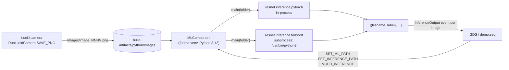

# Scales-ML

Machine-learning code for the SCALES testbench. F´ flight software on the
Jetson (`JetsonDeployment`, component `jetson_mlManager`) imports the
**flight inference** modules in this repo to classify images taken by the
Lucid camera. Everything else here is an experiment that F´ never calls.

This repo is a submodule of
[fprime-scales-ref](https://github.com/BroncoSpace-Lab/fprime-scales-ref) at
`Components/MLComponent/Scales-ML`.

## Documentation

| Page | Read it to learn |
|---|---|
| [docs/inference-pipeline.md](docs/inference-pipeline.md) | What happens from `SAVE_PNG` to the `InferenceOutput` event, the two runtimes (PyTorch and TensorRT), what each needs to run on CUDA, and known accuracy issues |
| [docs/resnet-18.md](docs/resnet-18.md) | How ResNet-18 turns a camera image into a label: preprocessing, layers, tensor shapes, and why camera images are harder than test images |
| [docs/adding-a-model.md](docs/adding-a-model.md) | How to add a new model that F´ can select with `SET_ML_PATH` |

The F´ side (commands, events, how `MLComponent` loads modules) is documented
in the parent repo: `Components/MLComponent/docs/sdd.md`.

## At a glance



## Flight entry points

| `SET_ML_PATH` value | Model | Runs in | One-time setup |
|---|---|---|---|
| `resnet.inference.pytorch` | ResNet-18, ImageNet (1,000 classes) | F´ process (`fprime-venv`) | None |
| `resnet.inference.tensorrt` | ResNet-18, ImageNet | Subprocess, JetPack Python + TensorRT | `make ml-trt-setup` |
| `yolo.inference.pytorch` | YOLOv8n, COCO (80 classes) | Subprocess, ultralytics | None |
| `yolo.inference.tensorrt` | YOLOv8n, COCO | Subprocess, JetPack Python + TensorRT | `make ml-trt-setup MODEL=yolo` |

`Sequences/demo.seq` uses `resnet.inference.pytorch`.

Every entry point implements the same contract:

```python
def main(folder: str) -> list[tuple[str, str]]:
    """One (filename, result string) pair per .png/.jpg/.jpeg in folder, sorted by name."""
```

## Run from the command line

Set up once from the parent repo root with `make jetson-setup` (installs
JetPack's CUDA/TensorRT, creates `ml-venv`, caches weights, builds engines,
runs the self-test). Then:

```bash
cd Components/MLComponent/Scales-ML

# Exactly what F´ does: fprime-venv hands the work to ml-venv on the GPU
../../../fprime-venv/bin/python -m resnet.inference.pytorch ../../../test-imagery
../../../fprime-venv/bin/python -m resnet.inference.tensorrt ../../../test-imagery

# Directly in the GPU interpreter
../../../ml-venv/bin/python -m resnet.inference.pytorch ../../../test-imagery

# Health check: CUDA stack, then preprocessing/CUDA/TensorRT/golden-label self-test
../../../ml-venv/bin/python -m scales_trt.cuda_check
../../../ml-venv/bin/python -m resnet.inference.selftest ../../../test-imagery
```

The PyTorch path prints `device: cuda` in its timing block; on a Jetson it
refuses to fall back to the CPU (set `SCALES_ML_DEVICE=cpu` to allow it). See
[Two Pythons](docs/inference-pipeline.md#two-pythons-why-inference-runs-in-a-child-process)
for why `ml-venv` exists.

## Layout

```
Scales-ML/
├── README.md
├── docs/                     This documentation
├── scales_trt/               [flight] Shared TensorRT runtime and F´ subprocess bridge
│   ├── fprime_wrap.py        Starts the worker under /usr/bin/python3, parses its JSON reply
│   ├── worker.py             CLI: `prepare` (export + build engine) | `infer` (run a folder)
│   ├── runtime.py            Build, load, and execute TensorRT engines (TRT 8/9/10)
│   └── jetson_compat.py      Workarounds for Jetson torch/torchvision builds (YOLO)
├── resnet/
│   ├── inference/            [flight]
│   │   ├── pytorch.py        ResNet-18 via Hugging Face + PyTorch, in the F´ process
│   │   ├── tensorrt.py       ResNet-18 via TensorRT (entry point)
│   │   └── trt_adapter.py    ONNX export, preprocess, postprocess for TensorRT
│   └── *.py                  Experiments: CIFAR-100 runs, FPS benchmark, training
├── yolo/inference/           [flight] Same structure as resnet/inference/
├── yolo/camera*.py           USB-camera live detection demos
├── mnist/ depth/ phi3/       Experiments: small CNN, depth estimation, small LLM
├── nannyml/                  Experiments: label-free accuracy estimation
└── tegrastats_avg.py         Jetson power/thermal log summary
```
