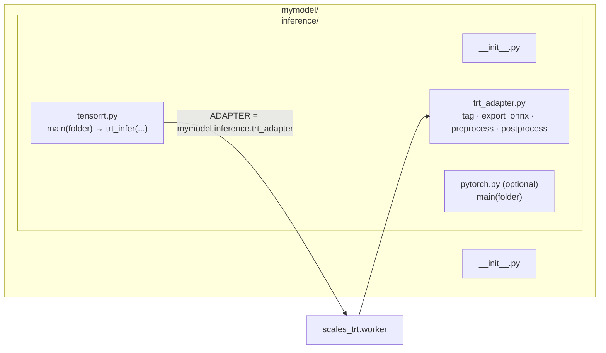

# Adding a model

How to add a model that F´ can select with
`jetson_mlManager.SET_ML_PATH "<name>.inference.<module>"`.

## What F´ needs

`MLComponent` accepts any importable module whose dotted name has the shape
`<package>.inference.<module>` and that defines:

```python
def main(folder: str) -> list[tuple[str, str]]:
    """One (filename, result string) pair per image in folder."""
```

The result string ends up in the `InferenceOutput` event (max 256
characters), formatted as `"<file> is an image of a <result>"`.

Scales-ML's root is already on F´'s import path, so a new `<name>/` package
is importable as soon as it exists. No copy step is needed.



## TensorRT model

1. **Copy a template.** `resnet/` for classification, `yolo/` for
   detection, to `<name>/`. Keep the `__init__.py` files in `<name>/` and
   `<name>/inference/`.

2. **Write `<name>/inference/trt_adapter.py`** with four functions:

   | Function | Contract |
   |---|---|
   | `tag(model) -> str` | Unique, filename-safe cache name |
   | `export_onnx(model, onnx_path, labels_path)` | Write a single-input, single-output ONNX file and a JSON label map. Runs once, at engine build. |
   | `preprocess(path) -> np.ndarray` | One image file → float32 NCHW, shape matching the ONNX input |
   | `postprocess(output, labels) -> str` | Raw engine output → one short string |

   `preprocess` must reproduce the preprocessing the model was trained with
   (resize method, crop, normalization, channel order). Check it by
   comparing its output against the reference processor on a few images;
   see [resnet-18.md](resnet-18.md#preprocessing).

3. **Write `<name>/inference/tensorrt.py`:**

   ```python
   import os, sys
   from scales_trt.fprime_wrap import trt_infer

   ADAPTER = "<name>.inference.trt_adapter"
   MODEL = os.environ.get("SCALES_<NAME>_MODEL", "<weights-or-hub-id>")

   def main(folder: str, model: str = MODEL):
       return trt_infer(ADAPTER, folder, model, "<Name>-TRT")

   if __name__ == "__main__":
       for n, c in main(os.path.abspath(sys.argv[1])):
           print(f"{n}: {c}")
   ```

4. **Teach `make ml-trt-setup` about it.** In the parent repo's
   `ml-trt-setup.sh`, add a branch to the `case "$MODEL"` block that sets
   `NAME` (same variable and default as `tensorrt.py`) and `EXPORT_DEP`
   (the package `export_onnx` imports).

5. **Build the engine** on the Jetson, as the service user, not `sudo`:

   ```bash
   make ml-trt-setup MODEL=<name>
   ```

6. **Test from the command line**, then from GDS:

   ```bash
   cd Components/MLComponent/Scales-ML
   ../../../ml-venv/bin/python -m <name>.inference.tensorrt ../../../test-imagery
   ```

   ```text
   jetson_mlManager.SET_ML_PATH "<name>.inference.tensorrt"
   jetson_mlManager.SET_INFERENCE_PATH "./Images"
   jetson_mlManager.MULTI_INFERENCE
   ```

## PyTorch-only model

Write `<name>/inference/pytorch.py` following `resnet/inference/pytorch.py`:

```python
from scales_trt.fprime_wrap import is_gpu_interpreter, run_module

def run_local(folder):            # the real work; runs in ml-venv
    import torch                  # heavy imports here, never at module top
    from scales_trt.cuda_check import select_device
    device = select_device()      # raises on a Jetson without CUDA
    ...
    return [(filename, result), ...]

def main(folder):                 # what F´ calls, from fprime-venv
    if is_gpu_interpreter():
        return run_local(folder)
    p = run_module("<name>.inference.pytorch", ["--worker", folder])
    return [tuple(x) for x in p["outputs"]]

# __main__: with --worker, print json.dumps({"ok": True, "outputs": run_local(folder)})
# as the last stdout line (or {"ok": False, "error": ...}); see resnet/inference/pytorch.py
```

F´'s `fprime-venv` has no CUDA torch (none exists for Python 3.12 on Jetson),
so the model must run under `ml-venv`
([why](inference-pipeline.md#two-pythons-why-inference-runs-in-a-child-process)).
Add any new packages to `requirements-jetson.txt` and re-run `make ml-setup`.

## Rules

- Keep `main` at module top level and avoid work at import time:
  `SET_ML_PATH` imports the module.
- Return `[]` for an empty folder; raise on real errors (F´ reports
  `EXECUTION_ERROR`).
- Process files in sorted order so results are reproducible.
- Print diagnostics to **stderr**. On the TensorRT path the last stdout
  line of the worker must be its JSON reply.
