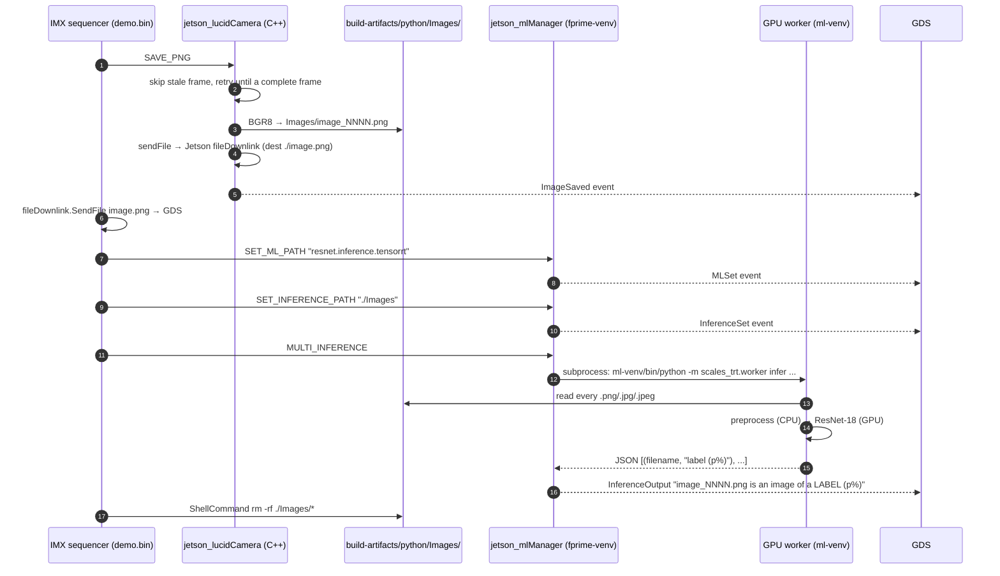
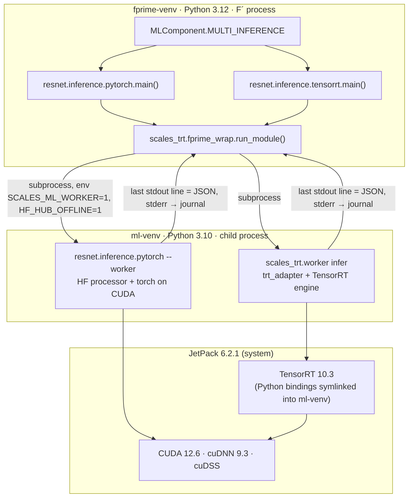
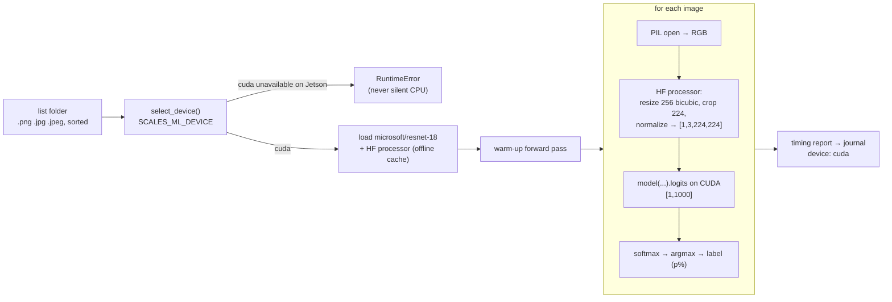
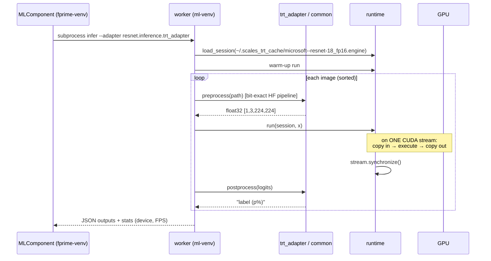
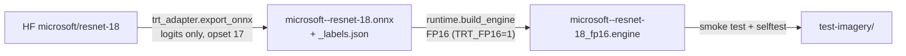
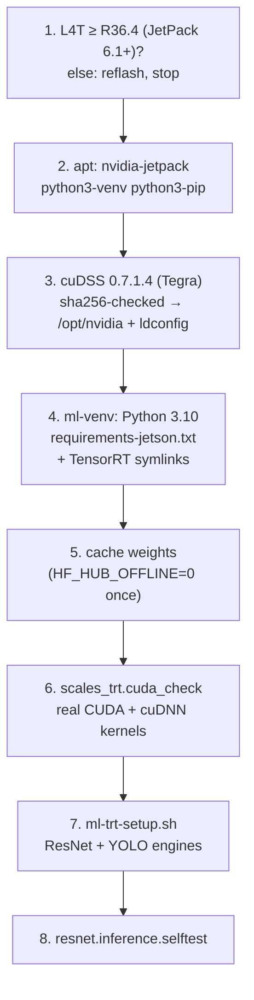

# Inference pipeline

How a camera image becomes an `InferenceOutput` event in GDS, which code runs
at each step, and how it reaches the Jetson GPU.

Paths are relative to the **parent repo** (`fprime-scales-ref`) unless they
start with a Scales-ML package name (`resnet/`, `scales_trt/`, ...).
Measured on the testbench Jetson Orin Nano Super, 2026-11-13.

- [End to end: `demo.seq`](#end-to-end-demoseq)
- [Step 1: image capture](#step-1-image-capture)
- [Step 2: model selection and dispatch](#step-2-model-selection-and-dispatch)
- [Two Pythons: why inference runs in a child process](#two-pythons-why-inference-runs-in-a-child-process)
- [Step 3a: PyTorch path](#step-3a-pytorch-path)
- [Step 3b: TensorRT path](#step-3b-tensorrt-path)
- [Setup: `make jetson-setup`](#setup-make-jetson-setup)
- [Verifying: `make ml-check`](#verifying-make-ml-check)
- [Configuration](#configuration)
- [Accuracy: fixed issues and remaining limits](#accuracy-fixed-issues-and-remaining-limits)

## End to end: `demo.seq`

`Sequences/demo.seq` is run from the IMX (`ImxDeployment`), which forwards the
`JetsonDeployment.*` commands to the Jetson:

```text
R00:00:00 JetsonDeployment.jetson_lucidCamera.SAVE_PNG
R00:00:03 imx_FileHandling.fileDownlink.SendFile, "image.png", "image.png"
R00:00:05 JetsonDeployment.jetson_mlManager.SET_ML_PATH, "resnet.inference.tensorrt"
R00:00:07 JetsonDeployment.jetson_mlManager.SET_INFERENCE_PATH, "./Images"
R00:00:09 JetsonDeployment.jetson_mlManager.MULTI_INFERENCE
R00:00:11 jetson_FileHandling.fileManager.ShellCommand, "rm -rf ./Images/*", "test.txt"
```



F´ runs with working directory `build-artifacts/python` (set by
`jetson-startup.sh`), so the camera's relative path `Images/...` and
`SET_INFERENCE_PATH "./Images"` point to the same folder.

## Step 1: image capture

Camera: LUCID Phoenix **PHX032S-C**, 2048 × 1536, color (BayerRG8), GigE.
`Components/RunLucidCamera/RunLucidCamera.cpp`:

**`SETUP_CAMERA`** (send once after boot; re-sending is harmless):

1. Open the Arena system, find the camera (retries for ~5 s), log its model,
   serial and IP.
2. Transport: auto-negotiate packet size, enable packet resend, and set
   `StreamBufferHandlingMode=NewestOnly` so a snapshot is never a stale queued
   frame.
3. Image defaults for ML: `ExposureAuto` and `BalanceWhiteAuto` = Continuous,
   `GammaEnable`=1, **`Gamma`=0.5**, **`TargetBrightness`=50**. Nodes a
   different camera model lacks are skipped; the event says how many applied.

**`SAVE_PNG`**:

1. `StartStream()`, discard the first frame.
2. `GetImage()` until a frame is **complete** (no lost packets), up to 30
   tries. Lost frames are reported (`Dropped N incomplete frame(s)`); if all
   30 are incomplete the last one is saved with a `CameraError` warning.
3. `Convert(..., BGR8)` (demosaic) and save an uncompressed PNG to
   `Images/image_NNNN.png`; `NNNN` resets when F´ restarts.
4. `sendFile_out` → the Jetson's `FileHandling.fileDownlink.SendFile`.
5. `StopStream()` (also on errors, so the next `SAVE_PNG` can start).

Why these settings, from captures on the testbench:

| Setting | Effect on the frame |
|---|---|
| Camera default, gamma 1.0 | Linear and dark: mean 71/255 |
| Gamma 0.5, auto gain | Washed out: 28% of pixels clipped |
| **Gamma 0.5, target brightness 50** | Mean 123/255, 0.2% clipped: closest to an ordinary photo |
| First frame after `StartStream`, no completeness check (old `SAVE_PNG`) | Horizontal streaks of garbage rows from lost packets |

## Step 2: model selection and dispatch

`Components/MLComponent/MLComponent.py`:

| Command | What it does |
|---|---|
| `SET_ML_PATH "<pkg>.inference.<mod>"` | Checks the name's shape, imports it, requires a callable `main`. Otherwise `VALIDATION_ERROR` and the previous model is kept. |
| `SET_INFERENCE_PATH "<dir>"` | Stores `os.path.abspath(dir)` if it is a directory. |
| `MULTI_INFERENCE` | Calls `model.main(path)`, then emits one `InferenceOutput` per result (0.1 s apart). An exception → `EXECUTION_ERROR`, with the traceback printed to the service journal. |
| `CLEAR_INFERENCE_PATH` | Forgets the folder. |

`main()` runs on the component's own thread, so a slow model blocks only
`jetson_mlManager`, not the rest of F´.

## Two Pythons: why inference runs in a child process



F´ needs Python 3.12 (`fprime-venv`). NVIDIA publishes CUDA-enabled PyTorch
for JetPack 6 (`pypi.jetson-ai-lab.io/jp6/cu126`) and TensorRT's Python
bindings only for JetPack's Python **3.10**. PyPI's aarch64 torch is a
CUDA 13 build that needs a newer driver than JetPack 6 has, so in
`fprime-venv` it silently runs on the CPU.

So both entry points hand the work to `ml-venv`, a Python 3.10 venv that
`make jetson-setup` creates:

- `scales_trt.fprime_wrap.jetson_python()` picks the interpreter:
  `SCALES_TRT_PYTHON` if set, else `<repo>/ml-venv/bin/python`, else
  `/usr/bin/python3`.
- `run_module()` starts `python -m <module> ...`, forwards the child's stderr
  (device line, timings, tracebacks) to F´'s stderr, and parses the last
  stdout line as `{"ok": true, "outputs": [...]}` or `{"ok": false, "error": ...}`.
  An error becomes a `RuntimeError` → `EXECUTION_ERROR`.
- `ml-venv` is isolated (no system site-packages, which would let apt's
  NumPy-1 SciPy break `transformers`); only JetPack's `tensorrt*` packages are
  symlinked in.
- The child reloads the model on every `MULTI_INFERENCE` (a few seconds).

## Step 3a: PyTorch path

`resnet/inference/pytorch.py`. From F´, `main()` re-runs the module as
`--worker` under `ml-venv`; there, `run_local()` does the work:



Device policy (`scales_trt/cuda_check.py`): `SCALES_ML_DEVICE=cuda` (the
default on a Jetson) raises if torch can't use the GPU; `auto` falls back to
CPU with a warning (the default elsewhere); `cpu` forces CPU.

## Step 3b: TensorRT path

`resnet/inference/tensorrt.py` → `scales_trt.fprime_wrap.trt_infer` →
`ml-venv/bin/python -m scales_trt.worker infer` → `scales_trt/runtime.py`.



Engines are built once per Jetson by `make jetson-setup` (or
`make ml-trt-setup [MODEL=yolo]`), as the service user, into
`~/.scales_trt_cache/`:



An engine is valid only for the GPU and TensorRT version that built it; after
a JetPack update delete `~/.scales_trt_cache` and run `make ml-setup`.

Timing on the testbench (11 `test-imagery` files, one `MULTI_INFERENCE`,
including process start and model load):

| Entry point | Wall time | Inference loop | Notes |
|---|---|---|---|
| `resnet.inference.tensorrt` | ~5 s | ~10 FPS | FP16 engine |
| `resnet.inference.pytorch` | ~12 s | ~7 FPS | FP32, CUDA |
| *before: PyTorch in fprime-venv* | *~93 s* | *~4.6 FPS* | *CPU, plus ~80 s of Hugging Face network checks* |

The GPU forward pass is a few milliseconds; the per-image time is now
dominated by decoding and resizing large images on the CPU.

## Setup: `make jetson-setup`

One command, from the parent repo, as the service user (it asks for the sudo
password once). Every step checks first and skips what's done. The GPU part is
`jetson-ml-setup.sh` (also `make ml-setup`):



Minimum platform: **JetPack 6.1 (L4T R36.4)**, which brings CUDA 12.6. The
Jetson torch wheels are built for exactly that, and the Orin Nano Super needs
JetPack 6.2 anyway. Older L4T can only be upgraded by reflashing (SDK
Manager or the SD-card image); the script stops with that message. JetPack 7
is rejected until the pinned wheels are updated.

`requirements-jetson.txt` pins torch 2.11.0 / torchvision 0.26.0 **by URL
and sha256** from NVIDIA's Jetson index. PyPI also has torch 2.11.0 for
aarch64 (CUDA 13), and pip ranks its `manylinux` tag above the Jetson wheel's
`linux_aarch64`, so an extra index alone would silently install the wrong one.

## Verifying: `make ml-check`

Runs `scales_trt.cuda_check` (torch, CUDA, a real matmul and cuDNN
convolution, TensorRT) and `resnet.inference.selftest` on `test-imagery/`:

| Check | Passes when |
|---|---|
| preprocess | `common.preprocess_image` (TensorRT path) equals the HF processor (PyTorch path); max difference ≤ 1e-4 (measured: 0) |
| cuda | PyTorch on CUDA gives the same top-1 as on CPU |
| golden | top-1 equals the recorded label for each `test-imagery` file |
| tensorrt | the cached engine gives the same top-1 as PyTorch |

## Configuration

Environment variables, read by the entry points and the worker. Set them in
`jetson-startup.sh` or the service environment.

| Variable | Default | Effect |
|---|---|---|
| `SCALES_TRT_PYTHON` | `<repo>/ml-venv/bin/python` | Interpreter for all GPU workers |
| `SCALES_ML_DEVICE` | `cuda` on Jetson, else `auto` | `cuda` / `auto` / `cpu` for the PyTorch path |
| `HF_HUB_OFFLINE` | `1` for workers | `0` lets Hugging Face download (adds ~80 s of network checks per call on the testbench) |
| `SCALES_ML_CONFIDENCE` | `1` | `0` reports the label without `(p%)` |
| `SCALES_RESNET_MODEL` | `microsoft/resnet-18` | Model for `resnet.inference.pytorch` |
| `SCALES_TRT_MODEL` | `microsoft/resnet-18` | Model for `resnet.inference.tensorrt` |
| `TRT_FP16` | `1` | `1` = FP16 engine, `0` = FP32 engine (separate cache files) |
| `SCALES_YOLO_WEIGHTS` | `yolov8n.pt` (`jetson-startup.sh` points it at the cached copy) | YOLO weights |
| `TRT_WORKSPACE_MB` | `256` | Builder scratch memory |
| `TRT_BUILD_HEARTBEAT_S` | `0` (`60` in `ml-trt-setup.sh`) | Progress messages during engine build |
| `YOLO_IMGSZ`, `YOLO_CONF_TH`, `YOLO_IOU_TH` | `640`, `0.25`, `0.45` | YOLO input size and thresholds |
| `SCALES_ML_BENCH` | `1` | `0` silences the PyTorch timing report |

## Accuracy: fixed issues and remaining limits

Fixed (2026-11-13):

| Issue | Was | Now |
|---|---|---|
| CUDA | PyPI CUDA 13 torch in `fprime-venv` → CPU; JetPack SDK and cuDSS missing | `ml-venv` with NVIDIA's CUDA 12.6 torch; `make jetson-setup` installs and verifies the stack; no silent CPU fallback |
| TensorRT preprocessing | Bilinear resize, different rounding; top-1 disagreed with the reference on 2 of 11 test images | Bit-exact copy of the HF pipeline; TensorRT FP16 agrees with PyTorch on 11/11 |
| TensorRT stream race | Input copied on the default stream, engine run on another, no dependency | Copy, execute, and readback on one stream |
| Corrupted camera frames | First frame saved without checking for lost packets | Stale frame discarded, retries until complete |
| Exposure / gamma | Linear (gamma 1.0), dark | Gamma 0.5, auto-exposure target 50 |
| Network at inference | Every call contacted huggingface.co (~80 s, or failure offline) | `HF_HUB_OFFLINE=1`; weights cached at setup |
| Confidence | Top-1 label only | `label (p%)` in the event |

Remaining limits:

| Limit | Effect | What to do |
|---|---|---|
| Camera network must run at **1000 Mb/s full duplex** | At 100 Mb/s half duplex nearly every frame lost packets (~3 fps, 100% incomplete). The bench switch's `LED2_1` strap had forced 100 Mb/s; fixed 2026-11-13: 33.6 fps, 0% incomplete | If links drop to 100/half, check the switch strap DIP switches (all OFF) and reset the switch; see the parent repo's README troubleshooting |
| Lens out of focus on the testbench | Blurry frames → low-confidence, wrong labels | Adjust the focus ring |
| ImageNet's 1,000 classes only | Objects outside them can't be labeled correctly | Point the camera at ImageNet-class objects for demos, or fine-tune on the target objects |
| ResNet-18 is a small model (~70% top-1 on ImageNet) | Even clean images are often wrong at low confidence | Use the reported confidence; consider a larger model with a TensorRT engine |

Baseline on `test-imagery` (both paths, CUDA), used by the self-test:

| File | Label | p | | File | Label | p |
|---|---|---|---|---|---|---|
| `ANYA_01-07-24.jpg` | Dandie Dinmont | 0.35 | | `europa_clipper.jpeg` | airship, dirigible | 0.11 |
| `Mars_helicopter_on_sol_46.png` | folding chair | 0.67 | | `nasa_perseverance_selfie.jpg` | moped | 0.38 |
| `SOFIA.jpg` | wing | 0.41 | | `sushi.jpg` | pizza, pizza pie | 0.31 |
| `astronaut.png` | neck brace | 0.34 | | `takoyaki.jpeg` | meat loaf, meatloaf | 0.37 |
| `cello.jpg` | cello, violoncello | 1.00 | | `whopper.jpg` | cheeseburger | 0.75 |
| `columbia.jpg` | space shuttle | 1.00 | | | | |
