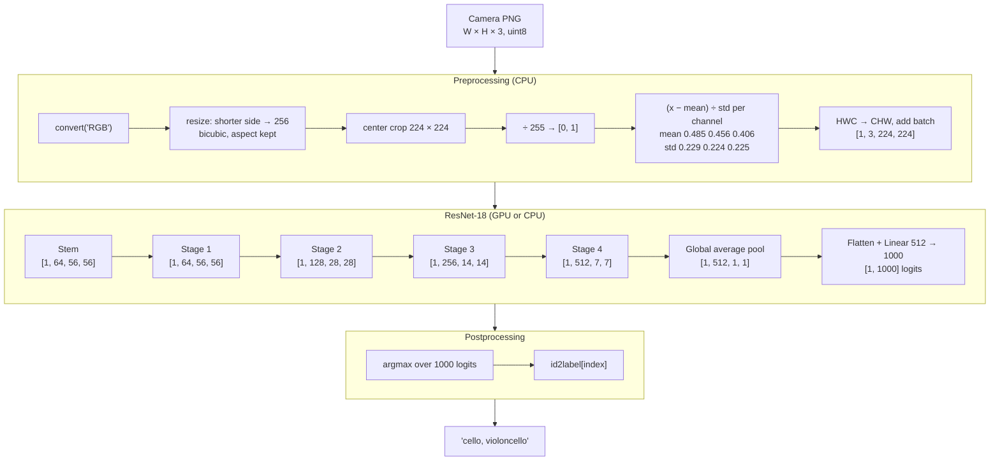
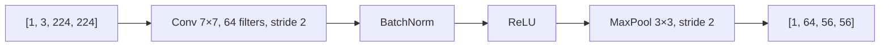
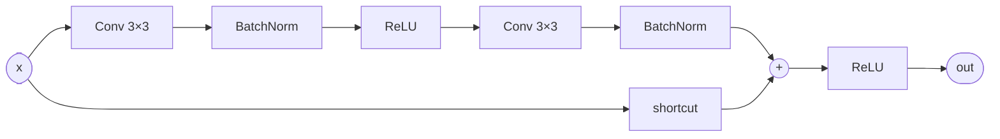
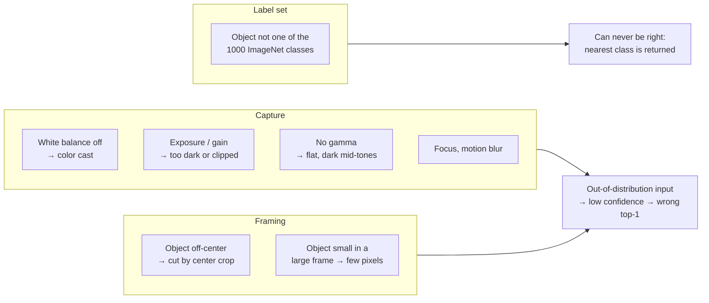

# How ResNet-18 classifies an image

The flight ResNet entry points (`resnet.inference.pytorch`,
`resnet.inference.tensorrt`) both run
[`microsoft/resnet-18`](https://huggingface.co/microsoft/resnet-18) from
the Hugging Face Hub. This page follows one image through it. Shapes below
were measured on the testbench Jetson with the model as loaded by
`ResNetForImageClassification`.

| Property | Value |
|---|---|
| Task | Image classification, one label per image |
| Training data | ImageNet-1k: about 1.28 M photos, 1,000 classes |
| Output classes | The 1,000 ImageNet labels (`model.config.id2label`), e.g. `cello, violoncello`, `space shuttle` |
| Parameters | 11,689,512 |
| Input | `[1, 3, 224, 224]` float32, RGB, ImageNet-normalized |
| Output | `[1, 1000]` logits (one unnormalized score per class) |
| ImageNet top-1 accuracy | about 70% (on ImageNet's own validation photos) |

## The whole path

## Preprocessing

The network only works if its input looks statistically like the images it
was trained on, so preprocessing must reproduce the training pipeline
exactly. A mismatch never raises an error; it just lowers accuracy.

| Step | Why |
|---|---|
| RGB | ImageNet weights expect R, G, B channel order. Swapped R/B looks like a different color scene to the model. |
| Resize shorter side to 256 (= 224 ÷ `crop_pct` 0.875), **bicubic** | Matches the scale objects had in training. The HF processor's config has `resample=3` (bicubic). |
| Center crop 224 × 224 | The network's fixed input size. Only the central square survives: for a 4:3 frame the crop keeps about 66% of the width and 87.5% of the height. An object near the edge of the frame is cut out. |
| ÷ 255, then subtract mean and divide by std | Puts each channel at roughly zero mean and unit variance, using ImageNet's statistics. |
| HWC → CHW, add batch dim | PyTorch and TensorRT expect `[N, C, H, W]`. |

`resnet.inference.pytorch` uses Hugging Face's `AutoImageProcessor`
(`ConvNextImageProcessorPil`), which is the reference definition.
`resnet/inference/common.py` (`preprocess_image`) re-implements the same steps
with PIL and numpy for TensorRT, bit for bit: the self-test measures a maximum
difference of 0 against the HF processor on every test image. An earlier
version resized with bilinear instead of bicubic; that alone changed the top-1
label on 2 of 11 test images (see
[Accuracy](inference-pipeline.md#accuracy-fixed-issues-and-remaining-limits)).

## The network

### Stem

A large first convolution picks up edges and color blobs, and the two
stride-2 steps shrink the image 4× per side to save compute.

### Residual stages

Four stages, two **basic blocks** each. Every stage after the first halves
the spatial size and doubles the channels, trading "where" for "what":

| Stage | Blocks | Output | Detects (roughly) |
|---|---|---|---|
| 1 | 2 | 64 × 56 × 56 | Edges, simple textures |
| 2 | 2 | 128 × 28 × 28 | Corners, repeated patterns |
| 3 | 2 | 256 × 14 × 14 | Object parts |
| 4 | 2 | 512 × 7 × 7 | Whole objects, scene layout |

One basic block:

- **Shortcut** is the identity in most blocks. In the first block of stages
  2-4, where the shape changes, it is a 1 × 1 conv with stride 2 plus
  BatchNorm so the two branches can be added.
- The block learns a *correction* to its input (`out = ReLU(x + F(x))`)
  rather than a whole new representation. That is what lets deep networks
  train well, and it is the "residual" in ResNet.
- "18" counts the weighted layers: 1 stem conv + 4 stages × 2 blocks × 2
  convs + 1 linear layer.

### Head

1. **Global average pool**: average each of the 512 feature maps over its
   7 × 7 grid → a 512-number summary of the image, independent of where
   the object was.
2. **Linear 512 → 1000**: one score (logit) per ImageNet class.
3. **argmax**: the highest logit wins. `softmax(logits)` turns the scores
   into probabilities that sum to 1; the winning probability is a rough
   confidence. The flight code currently discards it.

## Why camera images are harder

On `test-imagery/` (clean, centered internet photos) the winning
probability ranges from 1.00 (`cello.jpg`, `columbia.jpg`) down to 0.11
(`europa_clipper.jpeg`), and most are in the 0.3-0.4 range. The
low-confidence cases are where small input differences change the answer.
Lab camera frames start out further from ImageNet:

Checklist when a camera result looks wrong:

1. Open the downlinked PNG. Do the colors look natural? Is it sharp and
   well exposed?
2. Is the object near the center, and does it fill a good part of the
   frame?
3. Is the object one of the
   [ImageNet classes](https://huggingface.co/microsoft/resnet-18/blob/main/config.json)?
   If not, ResNet-18 will always return the nearest class it knows.
4. Run the same PNG through both `resnet.inference.pytorch` and
   `resnet.inference.tensorrt`. If they disagree, the problem is in the
   TensorRT preprocessing or runtime, not the image.
